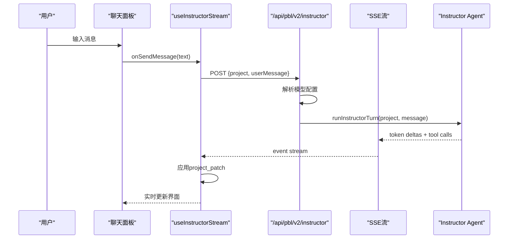
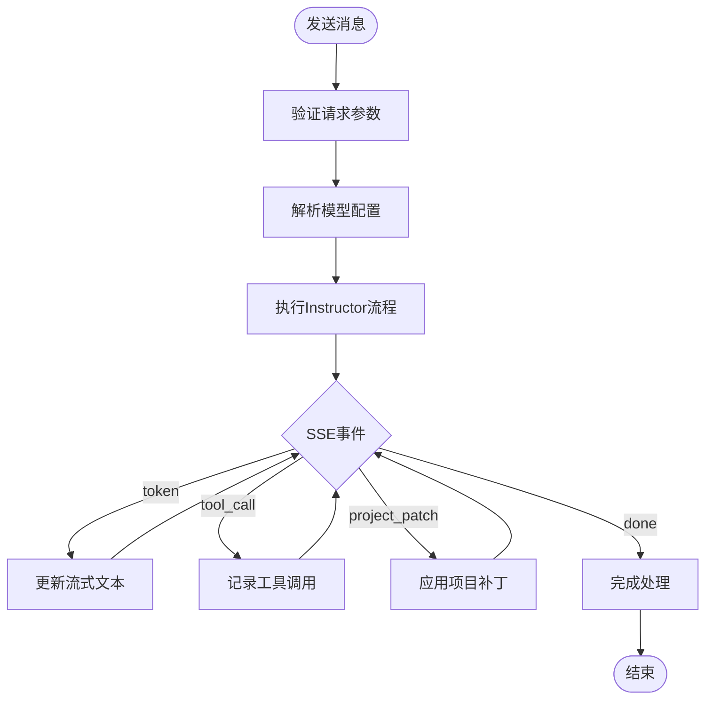
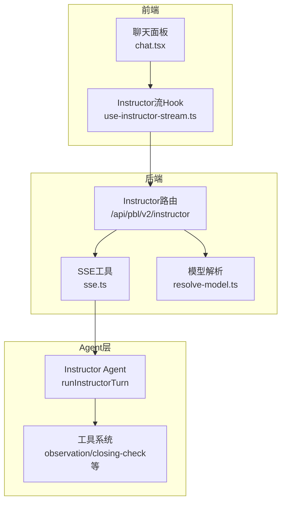
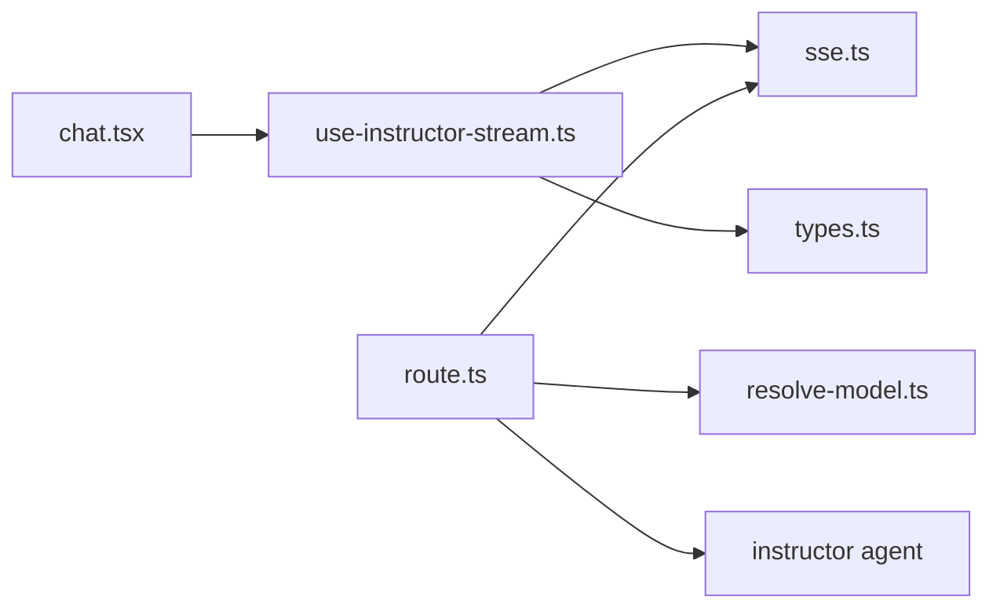

# PBL 聊天 API

<cite>
**本文引用的文件**   
- [app/api/pbl/v2/instructor/route.ts](file://app/api/pbl/v2/instructor/route.ts)
- [components/scene-renderers/pbl/v2/chat.tsx](file://components/scene-renderers/pbl/v2/chat.tsx)
- [lib/pbl/v2/types.ts](file://lib/pbl/v2/types.ts)
- [lib/pbl/v2/api/sse.ts](file://lib/pbl/v2/api/sse.ts)
- [lib/pbl/legacy/read.ts](file://lib/pbl/legacy/read.ts)
- [components/scene-renderers/pbl/v2/use-instructor-stream.ts](file://components/scene-renderers/pbl/v2/use-instructor-stream.ts)
- [lib/server/resolve-model.ts](file://lib/server/resolve-model.ts)
- [lib/server/api-response.ts](file://lib/server/api-response.ts)
</cite>

## 更新摘要
**变更内容**   
- 移除了PBL v1聊天API及相关组件（chat-panel.tsx、guide.tsx、issueboard-panel.tsx等）
- 全面迁移到PBL v2系统，采用基于SSE的流式架构
- 简化了智能体交互模式，从@mention路由改为统一的Instructor流式对话
- 保留了v1数据的向后兼容性读取能力

## 产品概述
PBL v2聊天API为项目式学习场景提供基于Server-Sent Events (SSE) 的实时流式对话能力。与v1版本不同，v2系统不再使用@mention路由机制，而是通过统一的Instructor接口处理所有学生消息。系统支持完整的任务流程管理、评估反馈和进度跟踪，提供更强大的教学辅助功能。

## 核心业务流程
- 学生在聊天面板输入消息，通过POST请求发送到`/api/pbl/v2/instructor`
- 服务端接收完整的PBLProjectV2状态和用户消息，解析模型配置
- Instructor智能体根据当前任务状态决定工具调用和执行流程
- 通过SSE流式返回token增量、工具调用记录和项目状态更新
- 前端实时更新界面，应用项目补丁并维护对话历史

图表来源 
- [components/scene-renderers/pbl/v2/chat.tsx](file://components/scene-renderers/pbl/v2/chat.tsx)
- [app/api/pbl/v2/instructor/route.ts](file://app/api/pbl/v2/instructor/route.ts)
- [lib/pbl/v2/api/sse.ts](file://lib/pbl/v2/api/sse.ts)

章节来源
- [app/api/pbl/v2/instructor/route.ts](file://app/api/pbl/v2/instructor/route.ts)
- [components/scene-renderers/pbl/v2/chat.tsx](file://components/scene-renderers/pbl/v2/chat.tsx)

## 功能模块清单
- 前端聊天面板（PBLV2Chat）
  - 职责：渲染对话历史、处理输入、管理流式响应、显示加载状态
  - 验收要点：支持多行输入、自动滚动、错误处理、流式文本显示
- Instructor流式Hook（useInstructorStream）
  - 职责：管理SSE连接、解析事件流、应用项目补丁、处理评估链
  - 验收要点：正确处理token增量、工具调用、项目状态更新、错误恢复
- 后端Instructor路由（/api/pbl/v2/instructor）
  - 职责：请求验证、模型解析、Instructor执行、SSE响应封装
  - 验收要点：参数校验、流式响应、错误处理、超时控制
- SSE事件系统
  - 职责：定义事件类型、创建SSE响应、处理心跳保活
  - 验收要点：事件格式标准化、连接稳定性、中间件兼容性
- 数据模型（PBLProjectV2）
  - 职责：定义项目结构、任务状态、对话历史、评估结果
  - 验收要点：类型安全、状态一致性、向后兼容

章节来源
- [components/scene-renderers/pbl/v2/chat.tsx](file://components/scene-renderers/pbl/v2/chat.tsx)
- [components/scene-renderers/pbl/v2/use-instructor-stream.ts](file://components/scene-renderers/pbl/v2/use-instructor-stream.ts)
- [app/api/pbl/v2/instructor/route.ts](file://app/api/pbl/v2/instructor/route.ts)
- [lib/pbl/v2/api/sse.ts](file://lib/pbl/v2/api/sse.ts)
- [lib/pbl/v2/types.ts](file://lib/pbl/v2/types.ts)

## 数据与状态
- 请求体结构
  - project: PBLProjectV2，完整的项目状态（包含任务、对话、评估等）
  - userMessage: string，用户输入的消息文本
  - phase?: InstructorPhase，可选的执行阶段（默认'instructing'）
- SSE事件类型
  - token: 文本增量，用于流式显示
  - tool_call: 工具调用记录，包含工具名称和参数
  - project_patch: 项目状态更新，用于应用更改
  - done: 流结束信号
- 关键状态流转
  - 前端维护项目状态副本，通过project_patch事件逐步更新
  - 支持多个评估阶段（task → milestone → final）的自动触发
  - 错误时保留已应用的补丁，确保状态一致性

图表来源 
- [components/scene-renderers/pbl/v2/use-instructor-stream.ts](file://components/scene-renderers/pbl/v2/use-instructor-stream.ts)
- [lib/pbl/v2/api/sse.ts](file://lib/pbl/v2/api/sse.ts)

章节来源
- [app/api/pbl/v2/instructor/route.ts](file://app/api/pbl/v2/instructor/route.ts)
- [components/scene-renderers/pbl/v2/use-instructor-stream.ts](file://components/scene-renderers/pbl/v2/use-instructor-stream.ts)
- [lib/pbl/v2/api/sse.ts](file://lib/pbl/v2/api/sse.ts)

## 关键约束与边界
- 请求验证：必须提供有效的project对象和非空userMessage
- 模型解析：通过resolveModelFromRequest统一处理，支持stage路由覆盖
- 流式响应：SSE连接需要保持活跃，支持心跳保活防止中间层断开
- 错误处理：捕获异常并返回标准错误格式，前端需处理网络错误
- 状态同步：project_patch事件按顺序应用，确保最终一致性
- 向后兼容：保留v1数据读取能力，自动升级到v2格式

章节来源
- [app/api/pbl/v2/instructor/route.ts](file://app/api/pbl/v2/instructor/route.ts)
- [lib/server/resolve-model.ts](file://lib/server/resolve-model.ts)
- [lib/pbl/legacy/read.ts](file://lib/pbl/legacy/read.ts)

## 架构总览

图表来源 
- [components/scene-renderers/pbl/v2/chat.tsx](file://components/scene-renderers/pbl/v2/chat.tsx)
- [components/scene-renderers/pbl/v2/use-instructor-stream.ts](file://components/scene-renderers/pbl/v2/use-instructor-stream.ts)
- [app/api/pbl/v2/instructor/route.ts](file://app/api/pbl/v2/instructor/route.ts)
- [lib/pbl/v2/api/sse.ts](file://lib/pbl/v2/api/sse.ts)
- [lib/server/resolve-model.ts](file://lib/server/resolve-model.ts)

## 详细组件分析

### 前端聊天面板（PBLV2Chat）
- 功能特性
  - 多行输入支持（Enter发送，Shift+Enter换行）
  - 流式文本显示，实时反映AI回复
  - 对话历史管理，自动滚动到底部
  - 错误处理和重试机制
  - 语音转写集成
- 状态管理
  - 维护本地项目状态副本
  - 通过project_patch事件同步服务器状态
  - 处理用户消息和AI回复的时间戳

章节来源
- [components/scene-renderers/pbl/v2/chat.tsx](file://components/scene-renderers/pbl/v2/chat.tsx)

### Instructor流式Hook（useInstructorStream）
- 核心逻辑
  - 管理SSE连接生命周期
  - 解析不同类型的事件（token、tool_call、project_patch）
  - 应用项目补丁到本地状态副本
  - 处理评估链（task → milestone → final）
- 错误处理
  - 连接失败时的重试机制
  - 部分失败的恢复策略
  - 用户友好的错误提示

章节来源
- [components/scene-renderers/pbl/v2/use-instructor-stream.ts](file://components/scene-renderers/pbl/v2/use-instructor-stream.ts)

### 后端Instructor路由（/api/pbl/v2/instructor）
- 请求处理
  - JSON请求体验证
  - 必填字段检查（project、userMessage）
  - 模型配置解析
- 执行流程
  - 应用区域设置到项目
  - 调用runInstructorTurn执行Agent逻辑
  - 封装SSE响应流
- 超时控制
  - 最大执行时间300秒
  - 信号取消支持

章节来源
- [app/api/pbl/v2/instructor/route.ts](file://app/api/pbl/v2/instructor/route.ts)

### SSE事件系统
- 事件类型定义
  - SSETokenEvent：文本增量事件
  - SSEToolCallEvent：工具调用事件
  - 其他扩展事件类型
- 响应封装
  - createSSEResponse函数
  - 自动添加SSE头部
  - 心跳保活机制
  - 信号取消支持

章节来源
- [lib/pbl/v2/api/sse.ts](file://lib/pbl/v2/api/sse.ts)

### 数据模型（PBLProjectV2）
- 项目结构
  - 基本信息（title、description、language）
  - 角色定义（roles）
  - 里程碑和微任务（milestones、microtasks）
  - 提交物和评估（submissions、evaluations）
  - 对话线程（threads）
  - 参与事件（engagementEvents）
- 运行时状态
  - UI阶段（uiPhase）
  - 项目状态（status）
  - 时间戳（createdAt、updatedAt）

章节来源
- [lib/pbl/v2/types.ts](file://lib/pbl/v2/types.ts)

## 依赖分析
- 前端依赖
  - React Hooks（useState、useEffect、useRef等）
  - 图标库（lucide-react）
  - i18n国际化
  - 音频组件（SpeechButton）
- 后端依赖
  - Next.js框架（NextRequest、Response）
  - 日志系统（createLogger）
  - 模型解析（resolveModelFromRequest）
  - AI SDK（LanguageModel）
- 外部依赖
  - AI提供商（OpenAI、Anthropic等）
  - 存储和持久化服务

图表来源 
- [components/scene-renderers/pbl/v2/chat.tsx](file://components/scene-renderers/pbl/v2/chat.tsx)
- [components/scene-renderers/pbl/v2/use-instructor-stream.ts](file://components/scene-renderers/pbl/v2/use-instructor-stream.ts)
- [lib/pbl/v2/api/sse.ts](file://lib/pbl/v2/api/sse.ts)
- [app/api/pbl/v2/instructor/route.ts](file://app/api/pbl/v2/instructor/route.ts)
- [lib/server/resolve-model.ts](file://lib/server/resolve-model.ts)

## 性能考虑
- 流式传输：SSE流式返回减少首字节延迟
- 状态同步：仅传输必要的增量更新（project_patch）
- 连接优化：心跳保活防止中间层断开连接
- 内存管理：及时清理不需要的状态和事件监听器
- 错误恢复：部分失败时的状态回滚和重试机制

## 故障排查指南
- 常见错误
  - INVALID_REQUEST：请求体格式错误或缺少必填字段
  - MISSING_REQUIRED_FIELD：project或userMessage为空
  - 网络连接错误：SSE连接建立失败或中断
- 调试建议
  - 检查浏览器开发者工具的Network标签，查看SSE连接状态
  - 验证项目状态是否正确传递到服务器
  - 确认模型配置和环境变量设置正确
  - 检查服务器日志中的错误堆栈信息

章节来源
- [app/api/pbl/v2/instructor/route.ts](file://app/api/pbl/v2/instructor/route.ts)
- [lib/server/api-response.ts](file://lib/server/api-response.ts)

## 向后兼容性
- v1数据读取：保留对历史PBL v1项目的读取能力
- 自动升级：将v1项目配置转换为v2格式
- 迁移路径：新创建的项目直接使用v2格式
- 混合支持：同一应用中可同时处理v1和v2项目

章节来源
- [lib/pbl/legacy/read.ts](file://lib/pbl/legacy/read.ts)

## 结论
PBL v2聊天API通过SSE流式架构提供了更高效、更可靠的实时对话体验。相比v1版本的@mention路由机制，v2系统采用了更简洁的统一接口设计，支持复杂的任务流程和评估机制。新的架构不仅提升了用户体验，还为未来的功能扩展奠定了坚实基础。建议在开发中充分利用SSE的流式特性，合理管理项目状态，确保良好的性能和用户体验。